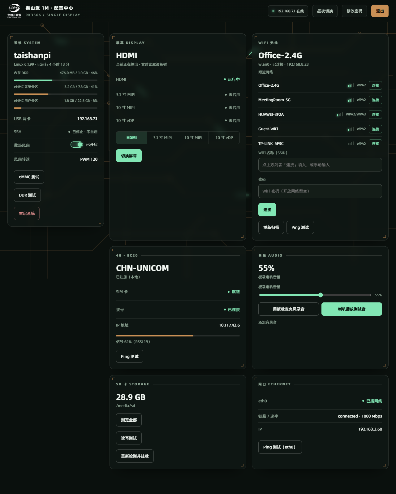
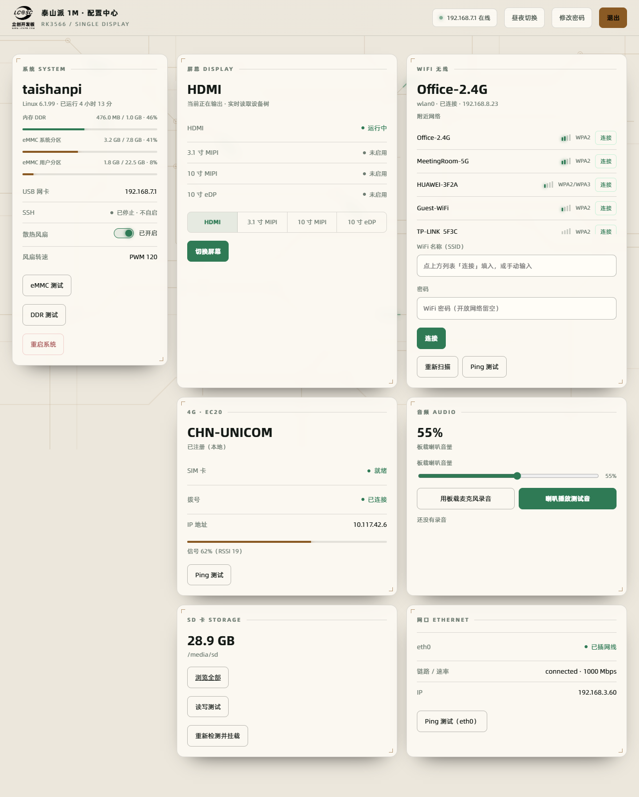

# 配置与管理

## 界面预览

暗色主题（默认）与亮色主题：





## 安装路径

| 文件 | 路径 |
| --- | --- |
| 程序 | `/usr/local/sbin/tspi-web.py` |
| LOGO | `/usr/local/share/tspi-web/logo-small.png` |
| systemd unit | `/etc/systemd/system/tspi-web.service` |

这些路径与泰山派 1M 定制 Debian 镜像（v0.4.2 起）保持一致。升级时用新仓库覆盖旧文件后重跑 `sudo ./packaging/install.sh` 即可。

## systemd 管理

```sh
systemctl status tspi-web            # 看运行状态
sudo systemctl restart tspi-web      # 改完配置后重启
sudo systemctl stop tspi-web         # 停止
sudo systemctl disable --now tspi-web  # 停止并取消开机自启
```

unit 里配置了 `Restart=always`，进程异常退出 3 秒后自动拉起。

## 监听地址与端口

- 服务只绑定 usb0 网卡上的地址（默认 192.168.7.1）。WiFi 和有线网口侧访问不到这个网页，是设计行为，不是故障。
- 端口默认 80。需要临时换端口时用环境变量 `TSPI_WEB_PORT`，例如把 unit 的 `[Service]` 段加一行：

  ```ini
  Environment=TSPI_WEB_PORT=8080
  ```

  然后 `sudo systemctl daemon-reload && sudo systemctl restart tspi-web`，之后用 `http://192.168.7.1:8080` 访问。

## 日志查看

```sh
journalctl -u tspi-web -f              # 实时跟踪
journalctl -u tspi-web --since today   # 今天的日志
```

每个 HTTP 请求记一行（来源地址 + 请求行），登录失败也会出现在这里，可用来排查是谁在尝试登录。

## 登录与密码

- 登录账号是板子的系统用户，默认密码来自所用镜像的出厂说明（本仓库不记录任何密码），首次登录后请立即在页面右上角「修改密码」处修改；
- 同一来源连续 5 次密码错误会锁定 5 分钟；
- 会话 Cookie 为 HttpOnly + SameSite=Strict，8 小时过期；关机重启后会话失效，需要重新登录。

## 回滚

- 覆盖安装前先备份旧程序：`sudo cp /usr/local/sbin/tspi-web.py /usr/local/sbin/tspi-web.py.bak`；
- 回滚时用备份覆盖回去，再 `sudo systemctl restart tspi-web`；
- 彻底移除：`sudo systemctl disable --now tspi-web && sudo rm -f /usr/local/sbin/tspi-web.py /etc/systemd/system/tspi-web.service`（LOGO 与目录可一并删除）。
